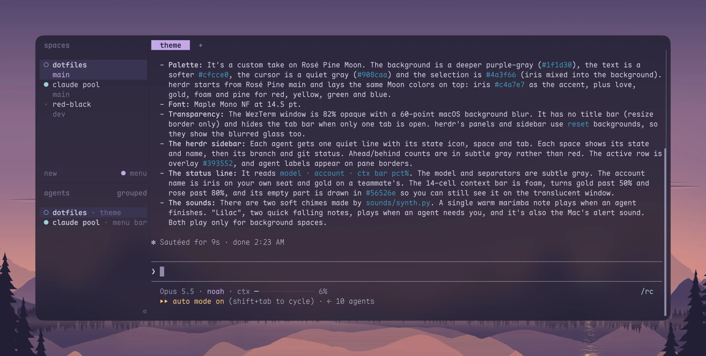
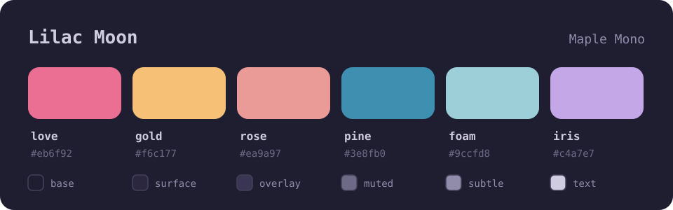
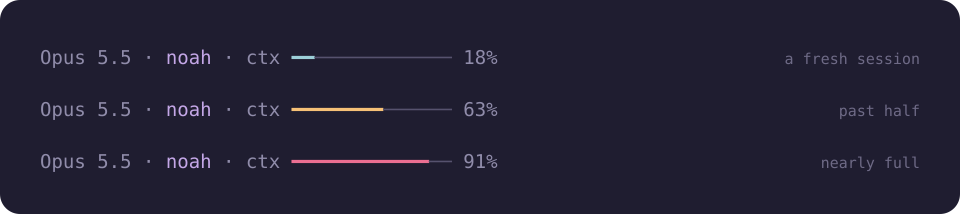
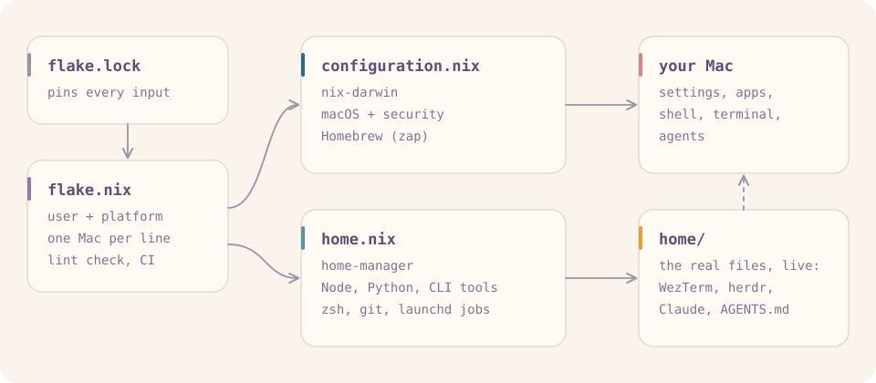
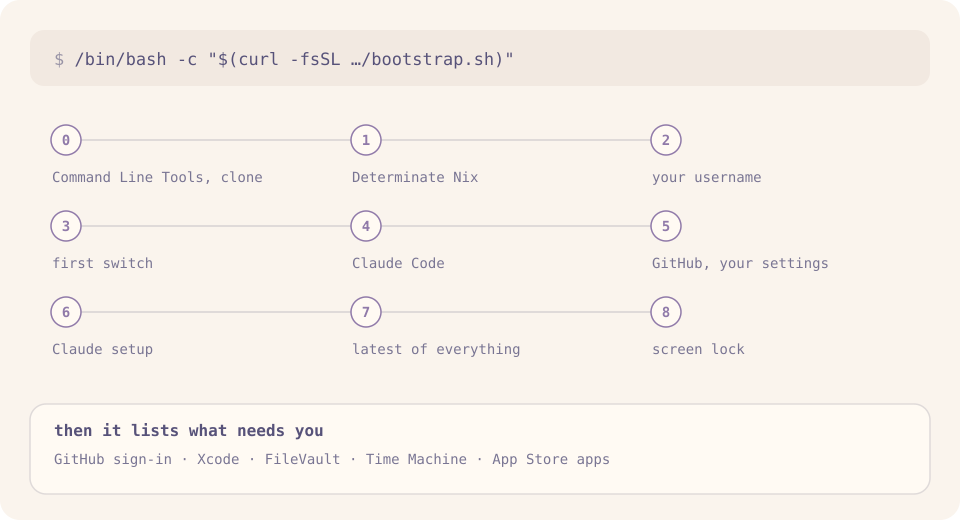

# dotfiles

<p align="center">
  
</p>

This is my whole Mac, written down. One command takes a brand new Mac to my exact setup:
system settings, apps, shell, terminal, and the way my coding agents work. One more command
applies every change after that.

I don't really read code anymore. I run a company, I'm in school, and most of my
software gets written by Claude Code and Codex while I steer. So this setup is less about a
perfect editor and more about making agents fast, safe and boring to run, and making the
Mac itself calm and something I never have to babysit.

This started as a copy of [Kun Chen's dotfiles](https://github.com/kunchenguid/dotfiles)
("dotfiles for agentic engineering"). The bones are his: nix-darwin plus home-manager in one
flake, the live-linked `home/` folder, one `AGENTS.md` shared by every agent. His
[walkthrough video](https://youtu.be/5N-okeDdIuI) is the best intro to the idea. Thanks, Kun.

## The look

I call it **Lilac Moon**: dark, calm and soft. Everything on screen shares one palette and
one font, and the same crescent moon shows up on the wallpaper, my desk mat and the wall.
**[See the whole setup](https://swiftlynoah.github.io/dotfiles/)**, from the keyboard
to the chimes.

<p align="center">
  
</p>

- **[Rosé Pine Moon](https://rosepinetheme.com), made my own** in WezTerm, herdr, Claude
  Code, VS Code and the prompt: a deeper purple-grey ground, softer lilac-grey text, a quiet
  grey cursor and a lilac selection. herdr only ships Rosé Pine's main and Dawn variants,
  so its config lays Moon's colors over main.
- **[Maple Mono](https://github.com/subframe7536/maple-font)** at 14.5 pt: round and soft,
  with Nerd Font icons.
- **See-through:** [WezTerm](https://wezterm.org) at 82% opacity with a macOS blur, and
  herdr's panels transparent too, so the wallpaper's lilac moon glows through.
- **A wallpaper that follows the sun:** [`wallpaper/`](wallpaper) paints a lilac crescent
  over a pine lake in twelve frames, from midnight through dawn, day, sunset and blue hour,
  and packs them into one dynamic wallpaper. macOS shows the frame that matches where the
  sun really is, so the lake goes dark at the actual dusk, in any season.
- **One sound for "something needs me":** "Lilac", two soft falling marimba notes, both
  when an agent has a question and as the Mac's alert.
- **A quiet [herdr](https://herdr.dev) sidebar:** one line per agent (a gold dot while it
  works, a soft ring when it's idle), and git's ahead/behind counts in gray instead of red.
- **Two chimes of my own** for agents in the background, made by
  [`synth.py`](home/.config/herdr/sounds/synth.py): one warm marimba note when an agent
  finishes ([listen](home/.config/herdr/sounds/done.mp3)), two notes rising like "hm?" when
  one needs me ([listen](home/.config/herdr/sounds/request.mp3)).
- **The Claude status line** says which model, which account and how full the conversation
  is. My name turns gold if the session moves to a teammate's account, and the context bar
  goes from foam to gold to rose as it fills:

<p align="center">
  
</p>

## How it fits together

<p align="center">
  <picture>
    <source media="(prefers-color-scheme: dark)" srcset=".github/readme/fits-together-dark.svg">
    
  </picture>
</p>

[Nix](https://nixos.org) builds all of it from `flake.lock`, so every Mac I set up gets the
same versions of everything. There are two kinds of config in here:

- **Declared in Nix** (`flake.nix`, `configuration.nix`, `home.nix`). Change it, run
  `./rebuild.sh`.
- **Live files** (everything in `home/`). My actual settings files are linked straight into
  this repo, so saving one changes my Mac on the spot. No rebuild.

## What's on my Mac

**macOS**: dark mode, fast key repeat, Dock and menu bar hidden (Dock on the left), Finder in
list view, tap to click, seconds on the clock, screenshots saved to Downloads, Touch ID for
`sudo`.

**Terminal**: zsh with autosuggestions (`Ctrl-F` accepts), the
[starship](https://starship.rs) prompt, and herdr to run a bunch of agents side by side.
File paths that agents print (`lib/api/requestAPI.ts:142`) open in VS Code at that line with
`Cmd`-click (or `Shift`-click inside herdr).

**Shortcuts**:

| Type | Runs |
| --- | --- |
| `cc` | Claude Code, through my account pool (`cc <session id>` picks a session back up) |
| `co` | Codex in full-auto mode |
| `ga`, `gc`, `gp`, `pull`, `m` | `git add .`, `git commit -m`, `git push`, `git pull`, `git switch main` |
| `mac-check` | my Mac's security checklist (below) |
| `mac-update` | update everything (below) |
| `mac-tidy` | clear what builds, browsers and agents left behind (below); `--dry-run` lists it |

**Apps and tools**:

| From | Where it's declared | What |
| --- | --- | --- |
| Nix | `home.nix` | Node 24, Python 3.14, uv, ripgrep, fd, fzf, jq, lazygit, gitleaks, delta, git + LFS, Maple Mono |
| npm (latest, in `~/.npm-global`) | `NPM_GLOBALS` in `home/bin/mac-update` | eas-cli, firebase-tools, vercel |
| Homebrew | `brews` in `configuration.nix` | herdr, gh, age, php, CocoaPods, fastlane, OpenJDK 21, idb-companion, AXe, ffmpeg, tectonic, poppler, tidy, cliclick, terminal-notifier |
| Homebrew casks | `casks` in `configuration.nix` | WezTerm, 1Password + CLI, Chrome, VS Code, Codex, Xcodes, Proxyman, Google Cloud CLI, AltTab, Hammerspoon, Maccy, LuLu, BlockBlock, OverSight |
| Official installer | `bootstrap.sh` | Claude Code (it updates itself) |

> [!WARNING]
> Homebrew here runs with `cleanup = "zap"`: every rebuild **uninstalls anything that isn't
> in those lists**, data included. I learned this the hard way. Add tools to
> `configuration.nix`, never with a bare `brew install`. If you already use Homebrew, compare
> `brew leaves` and `brew list --cask` with the lists before your first rebuild.

One Node for everything: the newest LTS line (24), no version manager. Python is 3.14,
with [uv](https://docs.astral.sh/uv/) for project environments.

No Neovim. Kun's setup ships a nice one, but I never open code by hand, so my editor is
VS Code (`$EDITOR` is `code --wait`), and I read markdown in a markdown app.

## Setting up a new Mac

You need an Apple Silicon Mac (on Intel, set `system = "x86_64-darwin"` in `flake.nix`), and
run it as yourself, not with `sudo`:

```sh
/bin/bash -c "$(curl -fsSL https://raw.githubusercontent.com/SwiftlyNoah/dotfiles/main/bootstrap.sh)"
```

<p align="center">
  <picture>
    <source media="(prefers-color-scheme: dark)" srcset=".github/readme/new-mac-dark.svg">
    
  </picture>
</p>

A new Mac has no git yet, so that first command fetches just `bootstrap.sh`. It installs
Apple's Command Line Tools (git comes with them), clones this repo to
`~/github/SwiftlyNoah/dotfiles`, and carries on from the clone. On a Mac that already has
the repo, `./bootstrap.sh` does the same. It's safe to run again if anything stops halfway.

- **Xcode:** a new Mac doesn't have it yet, so the first switch leaves out the one tool that
  needs it (idb-companion). Install Xcode with the Xcodes app (it needs your Apple ID), then
  run `./rebuild.sh` once more.
- **GitHub:** step 5 opens a browser to sign in. Every Mac makes its own SSH key for commit
  signing and registers it there, so no key ever has to travel between machines. Then it
  clones your private settings, if you have them (next section).
- **What's left** at the end needs a password or a person: FileVault, the Time Machine
  drives, Xcode, the App Store apps. Open a new terminal when it's done.

For work, `work-bootstrap` then clones each of your work repos and runs its own setup
script, which installs everything that repo needs and walks through each sign-in in the
browser. No credential files get copied between Macs.

## Your own settings

Everything personal lives outside this repo, in `local/`: a clone of a private repo of your
own named `dotfiles-local`, which bootstrap clones next to this one (step 5) and git here
ignores. Moving to a new Mac brings it along with no copying. Without one, everything runs
on [`local.example.json`](local.example.json), and copying that to `local/config.json` is a
fine way to start.

- **`config.json`**: your shared browsers (`browsers`: each one's launcher name, port, and
  the `folders` whose sessions use it; `defaultBrowser` takes every other session), a `⌘⇧` key for each of your Chrome profiles
  (`chromeProfiles`), the repos `work-bootstrap` sets up (`workRepos`), a Claude settings
  file every session starts with (`claudeSettings`), the dates `mac-update` leaves
  alone (`deployDays`), folders `mac-tidy` keeps a copy of on an external disk
  (`copies`: each a `from` folder and a `to` under `/Volumes`), and a disk for what isn't
  expected to be used again (`archive`).
- **`CLAUDE.md`**: notes for your agents that shouldn't be public, such as what each
  browser is signed in to. `claude-setup` imports it into `~/.claude/CLAUDE.md`.

The scripts read it live; a change to `browsers` needs `./rebuild.sh`, since the Dock and
the launchd jobs come from it.

## Everyday

```sh
./rebuild.sh        # apply changes to the Nix files (Touch ID)
nix flake check     # make sure everything evaluates and passes lint, without applying
nix fmt -- *.nix    # format the Nix files
```

`nix flake check` runs gitleaks over the whole repo, shellcheck, nixfmt, deadnix and statix,
plus syntax checks on the zsh scripts, JSON, TOML and Lua. GitHub Actions runs the same
thing, plus a dry-run build of the whole Mac, on every push.

## Staying up to date

There are attacks on old software every day, so everything here runs the latest version,
and nothing waits on me remembering to update it.

- **Every morning**, a launchd job upgrades Homebrew formulae and casks, the npm CLIs and
  uv's Pythons, then sends a notification saying what changed.
- **Every day**, a GitHub Action moves `flake.lock` forward (Node, Python and every other
  Nix package) and Homebrew itself to its newest release, builds the whole Mac to prove it
  works, and pushes. The morning job tells me when that's waiting.
- **`mac-update`** does all of it at once: pull, rebuild (Touch ID), upgrade everything, and
  run `mac-check`.
- macOS, App Store apps, Chrome, VS Code, 1Password and Claude Code update themselves.

The one exception is deploy days: `deployDays` in your own settings lists dates when the
morning job leaves everything alone, so a CLI can't change under a release. It catches up
the next day.

## Disk space

Builds, headless browsers and dozens of agent sessions fill a disk fast. An hourly launchd
job, `mac-tidy`, removes their leftovers once nothing has a file open in them:

- the copies of Chrome that Chrome leaves behind when automation kills it instead of
  quitting it (one per launch, hundreds a day);
- Claude Code scratchpads in `/private/tmp`, once their session has been idle for 3 days,
  and the processes such a session left running in its scratchpad after its parent died (a
  test harness's loops, a dev server);
- Xcode DerivedData for projects not built in a week, Xcode's shared module caches unused
  for a week, and packages `npx` hasn't run in a month;
- simulators for iOS versions no longer installed, and simulator runtimes no simulator uses
  (each platform's newest stays).

It also brings each of your `copies` up to date whenever its external disk is connected,
deleting nothing on either side, and moves Claude Code transcripts idle for two weeks to your
`archive` disk (under `Claude transcripts`), from where moving one back restores it.

## Security

My Mac does company work, so it gets the device rules a security review expects from any
laptop that touches company data, and a way to prove them:

```text
$ mac-check
PASS  FileVault: FileVault is On.
PASS  Firewall: Firewall is enabled. (State = 1)
PASS  Screen lock: display sleeps after 5 min idle, password asked at once
PASS  Automatic updates: check, download, security responses and macOS installs on
PASS  Time Machine: last backup 2026-10-26 (0 days ago)
PASS  Disk space: 75% used
PASS  Touch ID for sudo: on
PASS  Commit signing: commit.gpgsign=true, key present

mac-check 2026-10-26 21:00 on Noah's MacBook Pro: 8/8 pass
```

The last line is made to be pasted as evidence. It runs every night, and stays quiet unless
something fails.

Three of Objective-See's tools watch what the checks can't: LuLu asks before an app
connects somewhere new, BlockBlock speaks up when something installs itself to run in the
background, and OverSight tells me when the mic or camera turns on.

Everything it checks is declared in `configuration.nix` and `home.nix`, except FileVault and
the screen lock, which macOS only turns on with a person's password (bootstrap asks). On top
of that:

- **Every commit is signed** with this Mac's SSH key, so GitHub marks them Verified.
- **Every repo's pre-commit runs [gitleaks](https://github.com/gitleaks/gitleaks)**, so a key
  or token never makes it into a commit. That comes from one hooks dispatcher
  (`home/.config/git/hooks/dispatch`) that then runs the repo's own hooks, so per-repo
  hooks and Git LFS keep working.
- **Agents get shared browsers** with their own Chrome profiles, never my personal one
  (more below).

## Claude Code

- **`home/AGENTS.md`** is how I want every agent to behave (no em dashes, American spelling,
  reproduce bugs end to end before fixing them, and more). Codex and opencode read it
  directly. Claude reads it through `~/.claude/CLAUDE.md`, a file that lives only on my Mac,
  imports this one, and holds the parts that shouldn't be public.
- **The account pool**: [`claude-pool`](https://github.com/SwiftlyNoah/claude-pool)
  (private) runs sessions on my own seat, with backup accounts for when I run out, and shows
  every account's usage in a menu bar app. `home/bin/claude-setup` installs it, saves the
  flags `cc` starts with, registers the shared browser and Figma, and turns Claude in
  Chrome off (sessions use the shared browser instead).
- **The shared browsers**: `home/bin/agent-browser-mcp` connects Google's
  [Chrome DevTools MCP](https://github.com/ChromeDevTools/chrome-devtools-mcp) to a Chrome
  with its own profile, so every agent session, on any account, drives the same signed-in
  browser and I sign in to things once, by hand. There can be one per part of your life,
  and the session's folder picks one: say, a work browser for sessions in your work repos,
  and a personal one for everything else (`browsers` in your own settings). That keeps one
  context's sign-ins away from agents doing another's work, and each Google account in its
  own browser. 1Password fills passwords, only after I approve with Touch ID. A launchd job keeps each Chrome running (and relaunches it after Chrome updates
  itself); the profiles are readable only by me and kept out of Time Machine. Both are
  defined in `home/lib/agent-browser.zsh`, and each can have its own Chrome color, from a
  `#RRGGBB` line in `~/.config/agent-browser/<name>/theme-color`. They start in the
  background and open agents' pages behind my apps, so they never take focus. A session's
  pages close a few minutes after it ends (`home/lib/agent-browser-mcp/own-pages.mjs`),
  unless it's back by then (a pool switch restarts it); pages it didn't open stay.
- **Hooks**: `guard.mjs` has a session check with me before what can't be undone,
  whatever the permission mode: sending or forwarding mail, trashing mail, events or Drive
  files, sharing a Drive file, a force push to main, deleting a repo, `rm -r` on my home
  folder or a folder directly in it, erasing a disk. When I asked for it, that's one click.
  `auto-accept.sh` approves tool calls while a session is in accept-edits mode.
  `herdr-cc-resume.sh` makes herdr bring Claude panes back through `cc`. herdr installs its
  own hook beside them (`herdr integration install claude`) and owns that entry in
  `settings.json`.

> [!CAUTION]
> Agents that drive a signed-in browser can do whatever those accounts can. The debugging
> port has no password, so anything running on the Mac could drive it, and a web page that
> talks an agent into something gets to use those sign-ins. What actually limits the damage
> is how much those accounts can do: give them the least access the work needs, and
> two-step sign-in everywhere.

## Make it yours

Fork it, then:

- **`local/`**: your own settings (above). Start from `local.example.json`, and make it a
  private `dotfiles-local` repo so your next Mac gets it too.
- **`flake.nix`**: `user` and `system` (`bootstrap.sh` offers to set `user` for you). Adding a
  second Mac is one `mkMac` line there.
- **`home.nix`**: the git name and email are mine.
- **`home/AGENTS.md`**: my rules for agents. Rewrite them.
- **`configuration.nix`**: the Homebrew lists and the Dock. Read the zap warning above
  first.
- **`home/bin/claude-setup`**: assumes my account pool. Skip bootstrap step 6 if you don't
  have one.

## When something goes wrong

- **`brew bundle failed!` with a `bootsnap` error**: Homebrew sometimes deletes its own cache
  in the middle of an install. The package is usually fine (`brew list --versions <name>`).
  Run `./rebuild.sh` again.
- **`repository path ... is not owned by current user`**: shouldn't happen anymore.
  `rebuild.sh` uses a `path:` flake reference because the switch runs as root and git
  refuses to read a repo root doesn't own.
- **`nix` or `claude` not found right after bootstrap**: open a new terminal.
- **herdr says the Claude integration is outdated** (`herdr integration status`): run
  `herdr integration install claude`.
- **Mac App Store apps**: not managed here. Homebrew's `mas` support kept breaking rebuilds,
  so I install those by hand.

## Map

```
flake.nix                 inputs, my user and platform, mkMac, lint check, formatter
configuration.nix         nix-darwin: macOS settings, security, firewall, Homebrew
home.nix                  home-manager: packages, shell, git, live links, launchd jobs
bootstrap.sh              new Mac to done
rebuild.sh                apply the config (the first time too)
local.example.json        the format of your own settings (local/, ignored here)
home/
  AGENTS.md               rules for every coding agent
  .claude/                Claude Code settings, hooks and status line
  .config/git/hooks/      the hooks dispatcher (gitleaks, then the repo's own hooks)
  .config/wezterm/        WezTerm
  .config/herdr/          herdr's config and chimes (its runtime files aren't tracked)
  .hammerspoon/           app hotkeys (⌘⇧ A Chrome, D Messages, X Xcode, C Claude, + your profiles)
  bin/                    mac-check, mac-update, github-setup, claude-setup,
                          agent-browser-mcp, agent-browser-chrome, work-bootstrap
  lib/agent-browser.zsh   the shared browsers: ports, profiles, how Chrome starts
  lib/local-config.zsh    reads your own settings
  lib/agent-browser-mcp/  the browser server's npm pin
docs/                     Lilac Moon, the whole setup as one page (GitHub Pages)
.github/                  CI, the daily flake.lock update, Dependabot, README images
```
